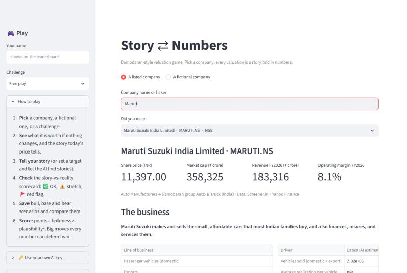
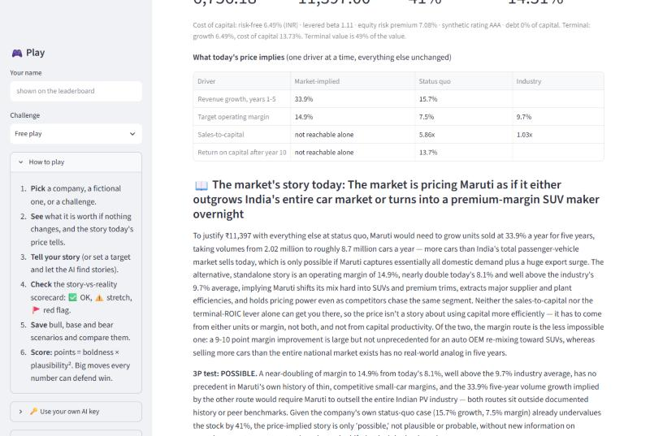
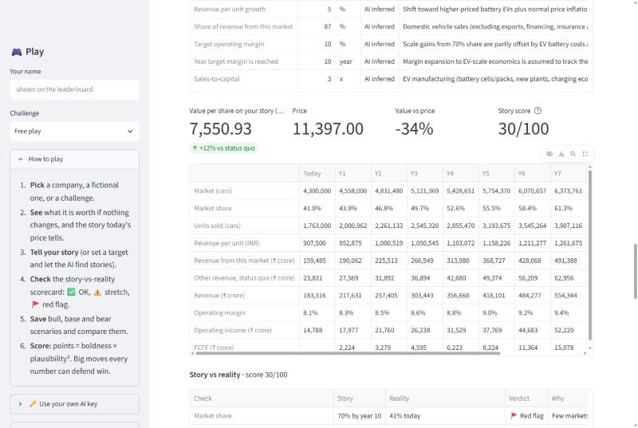
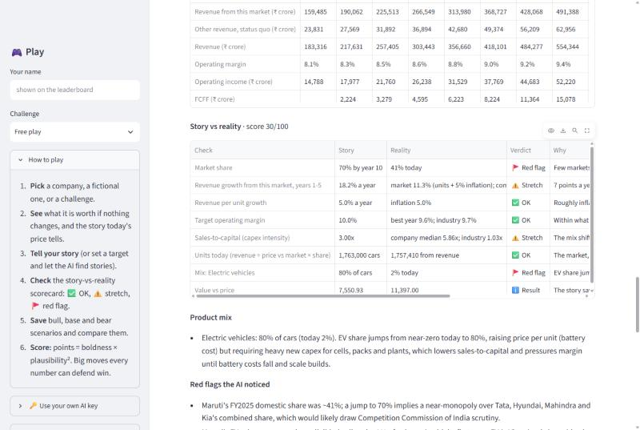
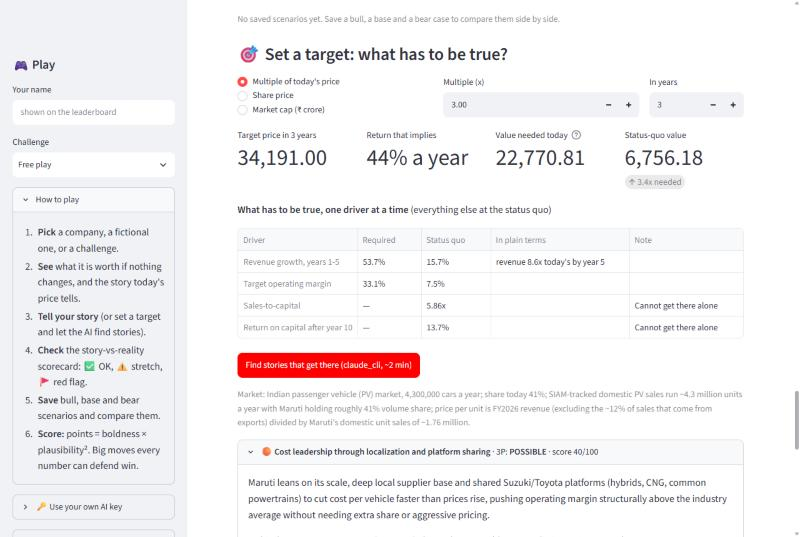
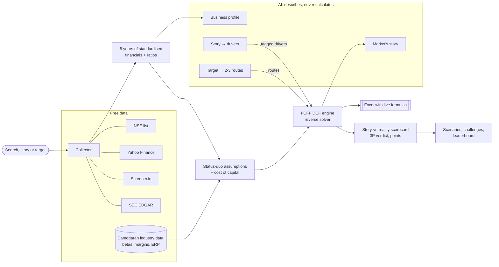

# Story ⇄ Numbers: a Damodaran-style valuation game

> Every valuation is a story told in numbers. — the idea behind Aswath Damodaran's *Narrative and Numbers*

Type a company and get five years of financials, a business profile and a DCF. Then play with it two ways:
- **Story → numbers:** "Maruti takes 70% of India's car market and 80% of its cars are EVs" becomes cars sold, prices, margins, capital needs, a value per share, and a scorecard that says where the story stops being believable.
- **Numbers → story:** "Maruti 3× in 3 years" shows what has to be true, and the AI proposes stories that get there, each graded on Damodaran's possible / plausible / probable test.

Everything downloads as an Excel file with **live formulas**: change a blue cell and the value per share recalculates.



## A worked example: what has to be true for Maruti to triple?

| | |
|---|---|
| Price today | ₹11,397 |
| Worth if nothing changes (status-quo DCF) | ₹6,756 |
| 3× in 3 years means a price of | ₹34,191 (44% a year) |
| Value needed today, discounted at the 14.5% cost of equity | ₹22,771, which is 3.4× the status quo |
| **One driver alone would need** | 54% revenue growth a year (8.6× today's revenue by year 5), **or** a 33% operating margin (the industry earns 10%) |

The AI proposed three ways to get there. The engine pushed each one until it hit the target, then graded it:

| Story | What it would take | Verdict |
|---|---|---|
| 🟠 Cost leadership (localisation, shared platforms) | A 37.8% margin, against a realistic 14% | Possible |
| 🟠 Premiumize via SUVs and Nexa | Revenue per car rising 35% a year | Possible |
| 🔴 Win the EV entry segment and export | Not enough even at a 95% market share | Out of reach |

Tripling in three years needs something no carmaker has done. The tool says so, with the numbers.

| What today's price implies | Your story, in units | Story vs reality | What has to be true |
|---|---|---|---|
|  |  |  |  |

## How it works



- **The AI only describes.** It writes the profile, turns words into drivers (each tagged *your story* or *AI inferred*) and narrates. Every number is computed in Python, shown, editable and checked against the company's history and its Damodaran industry.
- **The DCF** follows Damodaran's structure: 10 years, then a stable-growth terminal value. Margins converge to a target, reinvestment = growth ÷ sales-to-capital, and the cost of capital is built bottom-up (industry beta, country risk premium, synthetic rating). It also handles tax-loss carryforwards and failure probability.
- **Revenue in a story** is built bottom-up: market size × market share × revenue per unit. Revenue from other businesses keeps its status-quo growth.
- **Two AI backends:** the Claude CLI (a Claude Pro plan) locally, and the Gemini free tier for the public demo. Visitors can bring their own free Gemini key for their session.

## AI quality: the prompt evaluation set
`evals/stories.json` holds 20 stories across 7 companies. Each comes with expected driver ranges: stated numbers must be used exactly and tagged *your story*, and inferred ones must be sensible (e.g. Maruti's market share today 35–47%). Run it against any backend:
```bash
.venv/Scripts/python -m app.evals --provider gemini --pause 6
.venv/Scripts/python -m app.evals --provider claude_cli
```
Latest results are in `evals/results_<provider>.csv`.

## Run it yourself (Windows)
```bash
py -3.12 -m venv .venv
.venv/Scripts/python -m pip install -r requirements.txt
copy .env.example .env
.venv/Scripts/python -m streamlit run app/ui/streamlit_app.py
```

| Use | AI backend | One-time setup | `.env` |
|---|---|---|---|
| Personal, local | Claude Code CLI on your Claude Pro plan | `claude auth login` in a terminal | `LLM_PROVIDER=claude_cli` |
| Public demo | Gemini free tier | Free key at https://aistudio.google.com/apikey | `LLM_PROVIDER=gemini`, `GEMINI_API_KEY=...` |

After setup, **double-click `play.bat`** to play on your own computer with Claude (it opens http://localhost:8501).

`LLM_PROVIDER=auto` uses Claude when the CLI is installed and Gemini otherwise. Without any AI, the valuations, Excel files, requirements and scorecards still work. Command-line export: `.venv/Scripts/python -m app.collect "Maruti Suzuki"`.

To deploy the public demo for free, see [DEPLOY.md](DEPLOY.md).

## What's in the app
- **Company page:** NSE-named search suggestions, five years of financials and ratios, Damodaran industry benchmarks and an AI business profile (segments, unit drivers, competitive position).
- **Status quo and the market's story:** the value if nothing changes, and what today's price implies, one driver at a time and in plain language.
- **Tell your story (Mode A):** AI drivers you can edit, a units × price table, value per share, and a story-vs-reality scorecard (✅ OK / ⚠️ stretch / 🚩 red flag).
- **Set a target (Mode B):** the value needed today, one-driver requirements, and AI routes calibrated to the target and graded.
- **Play:** points = boldness × plausibility². Save bull / base / bear scenarios and compare them side by side. Six challenges (e.g. "Make Paytm worth ₹2,000", "A ₹1,000 crore quick-commerce startup") and a leaderboard.
- **Fictional companies:** describe a startup, and the AI drafts numbers you can edit and value.
- **Excel:** Summary, Story, Your story, Target, DCF (live formulas), Financials, Ratios, Benchmarks and the raw statements.

### Data (all free)
| Source | Used for |
|---|---|
| NSE equity list | Search suggestions with NSE's official names (a bundled copy is used if NSE is unreachable) |
| Yahoo Finance | Prices, profile, balance-sheet detail, non-Indian companies |
| Screener.in | Indian companies: headline financials in ₹ crore |
| SEC EDGAR | US companies: 10-K figures. Set `SEC_USER_AGENT` in `.env` with your contact email, as SEC asks |
| Aswath Damodaran (NYU Stern) | Industry betas, margins, sales-to-capital, country risk premiums, inflation. Refresh each January: `python -m app.data.damodaran refresh` |

Odd cases are handled: fiscal-year changes (the gap is flagged, and growth uses the real years between figures), companies reported in two currencies, banks (with a warning), delisted tickers and rate limits (polite retries).

### Tests
```bash
.venv/Scripts/python -m pytest -q
```

---
*Educational tool, not investment advice. AI output can be wrong: every AI number is labelled and editable. Not affiliated with or endorsed by Professor Damodaran or any data provider.*
